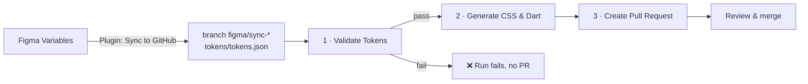

# Figma Design Pipeline

Change a variable in Figma, press **Sync**, and GitHub Actions does the rest:

```
✓ Tokens Validated   →   ✓ CSS & Dart Generated   →   ✓ Pull Request Created
```

A working, end-to-end CI/CD loop for design tokens that runs on **any Figma plan** (no Enterprise needed).



## Why a plugin and not the Figma REST API?

Figma's Variables REST API (`GET /v1/files/:key/variables/local`) only works for full seats in **Enterprise** orgs. The Plugin API (`figma.variables`) works on every plan, so the plugin reads the variables inside Figma and commits them to GitHub itself.

## Prior art

This is not a new idea. It is a small, open, fully inspectable implementation of a known pattern:

- [figma/variables-github-action-example](https://github.com/figma/variables-github-action-example) — Figma's official example (Enterprise only).
- [Tokens Studio](https://tokens.studio) + [Style Dictionary](https://styledictionary.com) — the most mature token workflow.
- [TokensBrücke](https://github.com/tokens-bruecke/figma-plugin), GitFig, Design System Sync — plugins that push variables to GitHub.

What this repo adds: a design-system **rules gate** (WCAG contrast, naming, ranges, aliases), live pipeline status **inside the plugin**, and a minimal codebase you can read in 15 minutes.

## What's inside

| Path | What it does |
|---|---|
| `figma-plugin/` | The "Sync to GitHub" plugin: exports variables to W3C DTCG JSON, commits to a new `figma/sync-*` branch, then shows the Actions stages live |
| `tokens/tokens.json` | Source of truth, written by the plugin |
| `pipeline.config.json` | Design-system rules: allowed collections, min/max values, required tokens, contrast pairs |
| `scripts/validate.mjs` | Validator. Emits GitHub annotations + a job summary |
| `scripts/build.mjs` | Style Dictionary v4 → `build/css/tokens.css` and `build/dart/tokens.dart` |
| `scripts/summary.mjs` | Token diff vs `main`, used as the PR description |
| `scripts/test.mjs` + `tests/` | 12 fixtures proving the validator catches bad files |
| `.github/workflows/design-pipeline.yml` | The 3-stage pipeline |
| `preview/index.html` | A page styled only by the generated CSS |

### What the validator checks

1. Valid JSON
2. Known collection (`color`, `spacing`, `radius`) with the right `$type`; lowercase kebab-case names
3. No two tokens produce the same CSS variable name
4. Colors are `#RRGGBB`/`#RRGGBBAA`; dimensions are `Npx` within the configured range; aliases point to existing tokens of the same type, no cycles
5. Required tokens exist
6. **WCAG AA contrast** for configured pairs (e.g. button text on primary ≥ 4.5:1)

## Setup (one time, ~5 minutes)

### 1. Repository settings
**Settings → Actions → General → Workflow permissions**
- Select **Read and write permissions**
- Tick **Allow GitHub Actions to create and approve pull requests**

### 2. A fine-grained token for the plugin
**GitHub → Settings → Developer settings → Fine-grained tokens → Generate new token**
- Repository access: **Only select repositories** → this repo
- Permissions: **Contents: Read and write**, **Actions: Read-only**, **Pull requests: Read-only** (Metadata is added automatically)
- Optional, to see the exact failing token inside the plugin: **Checks: Read-only** — if your token page doesn't offer it, the plugin still links to the failing run

The token is pasted **only** into the plugin. It is stored with `figma.clientStorage` on your computer and never committed. The workflow itself uses the built-in `GITHUB_TOKEN`; no repository secrets are needed.

### 3. Load the plugin (Figma desktop app)
**Menu → Plugins → Development → Import plugin from manifest…** → choose `figma-plugin/manifest.json`.

Open your design file → **Plugins → Development → Design Pipeline — Sync to GitHub**. Fill Owner / Repository / Base branch / Token → **Save & test**.

## The demo (what to film)

1. In Figma, open **Local variables** → change `Color / brand/primary` (e.g. `#5B3DF5` → `#E0462F`). The card's button changes on canvas.
2. Run the plugin → **Sync to GitHub**.
3. The plugin shows: *Exported 19 variables* → *Pushed figma/sync-…* → the three pipeline stages turn green one by one.
4. On GitHub: the Actions run, the job summary with contrast ratios, then the PR with a before/after table and the regenerated `tokens.css` / `tokens.dart` in **Files changed**.

**Failure take:** set `brand/primary` to a light color like `#C9C2FF`. Stage 1 fails on WCAG contrast, the PR is never created, and the plugin shows the reason.

## Run locally

```bash
npm ci
npm test          # validator self-test (12 cases)
npm run pipeline  # validate + build
npm run summary -- path/to/old-tokens.json   # diff summary
```

## Mapping rules (Figma → tokens)

| Figma | tokens.json |
|---|---|
| Collection `Color` | top-level group `color` (name lowercased) |
| Variable `brand/primary` | `color.brand.primary` |
| COLOR | `{"$type":"color","$value":"#RRGGBB"}` |
| FLOAT | `{"$type":"dimension","$value":"16px"}` |
| Alias | `"$value": "{color.neutral.0}"` |

Only each collection's **default mode** is exported. STRING/BOOLEAN variables are skipped with a warning. Each token keeps its Figma `variableId` in `$extensions` so later steps can point back to the variable.

## Limitations

- One mode per collection (enough for Figma Starter; multi-mode themes are a next step).
- The plugin creates a new branch and PR per sync; close stale PRs after merging.
- Tokens flow one way: Figma → code.

## License
MIT
